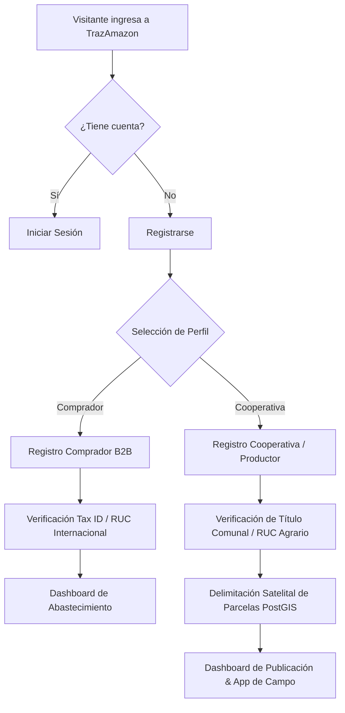

# Arquitectura de Gobernanza, Roles de Usuario y Autenticación B2B — TrazAmazon

Este documento define la arquitectura de identidad, control de acceso basado en roles (RBAC), flujo de onboarding y custodia de transacciones para el ecosistema **TrazAmazon**.

---

## 1. Perfiles de Usuario del Ecosistema

TrazAmazon articula una plataforma de doble vía con dos arquetipos principales de usuario:

### A. Comprador Corporativo / Importador B2B (`BUYER_B2B`)
- **Público Objetivo**: Casas chocolateras de especialidad, tostadores de café de origen, laboratorios de cosmética botánica, distribuidores mayoristas e importadores de la Unión Europea, Norteamérica y Asia.
- **Necesidades Principales**:
  - Garantía legal de no-deforestación requerida por el Reglamento Europeo Cero Deforestación (EUDR) y CSRD.
  - Trazabilidad satelital exacta hasta el árbol o polígono de cosecha.
  - Muestreo técnico rápido (500g) puerta a puerta vía DHL Green Express.
  - Contratos forward, pre-cosecha y acuerdos multi-anuales con precios FOB/CIF estables.
  - Custodia de pagos mediante Escrow bancario internacional.
- **Permisos en Plataforma**:
  - Explorar y filtrar lotes mayoristas con telemetría en tiempo real.
  - Solicitar muestras técnicas con certificado fitosanitario SENASA emitido.
  - Emitir Órdenes de Compra (PO) y firmar contratos de suministro.
  - Descargar expedientes satelitales GeoJSON para auditoría aduanera.

---

### B. Cooperativa / Productor Vendedor (`PRODUCER_COOP`)
- **Público Objetivo**: Pequeñas cooperativas agrarias, comunidades nativas tituladas (Amahuaca, Ese Eja, Shipibo) y comités de productores agroforestales de la cuenca amazónica.
- **Necesidades Principales**:
  - Comercialización directa sin intermediarios especulativos, obteniendo hasta +35% de ingreso neto familiar.
  - Registro de cosechas en campo **sin señal celular ni internet** (offline-first PWA).
  - Emisión automática de pasaporte digital de trazabilidad con validación satelital PostGIS.
  - Diversificación de ingresos a través de reservas de agroturismo vivencial en sus comunidades.
- **Permisos en Plataforma**:
  - Administrar perfil de cooperativa, personería jurídica y acreditaciones.
  - Publicar y actualizar lotes de cosecha con fotos, especificaciones de cata y volumen disponible.
  - Acceder a la App Móvil de Campo para registrar pesajes, geolocalización satelital y fotos.
  - Gestionar solicitudes de cotización, muestras y reservas de agroturismo.

---

## 2. Flujo de Autenticación y Onboarding

---

## 3. Seguridad de Transacciones: Modelo Escrow

Para garantizar la seguridad de compradores y productores:
1. **Acuerdo Comercial**: Se pacta el precio FOB/CIF y volumen mínimo (MOQ).
2. **Depósito en Custodia**: El comprador deposita los fondos en una cuenta Escrow bancaria autorizada.
3. **Control de Calidad & Despacho**: La cooperativa prepara el lote en sacos GrainPro o cajas al vacío con N2. SENASA emite el certificado fitosanitario oficial.
4. **Liberación de Fondos**: Los fondos se liberan a la cooperativa contra la presentación del Bill of Lading (BL) marítimo/aéreo y el informe de conformidad.

---
*Documento aprobado como base de diseño del sistema TrazAmazon.*
